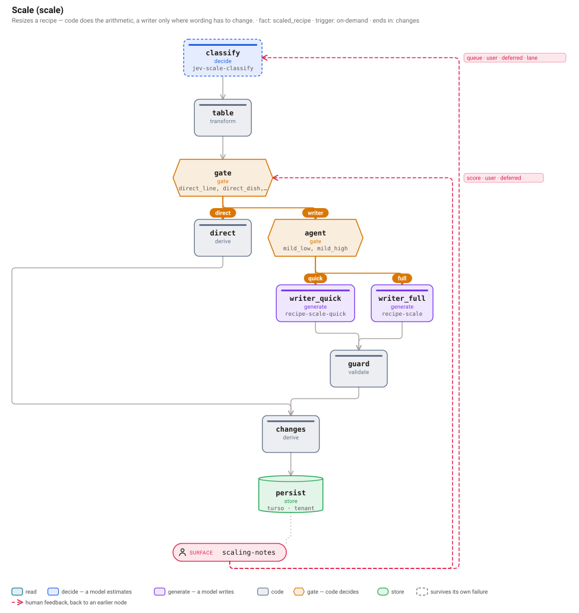
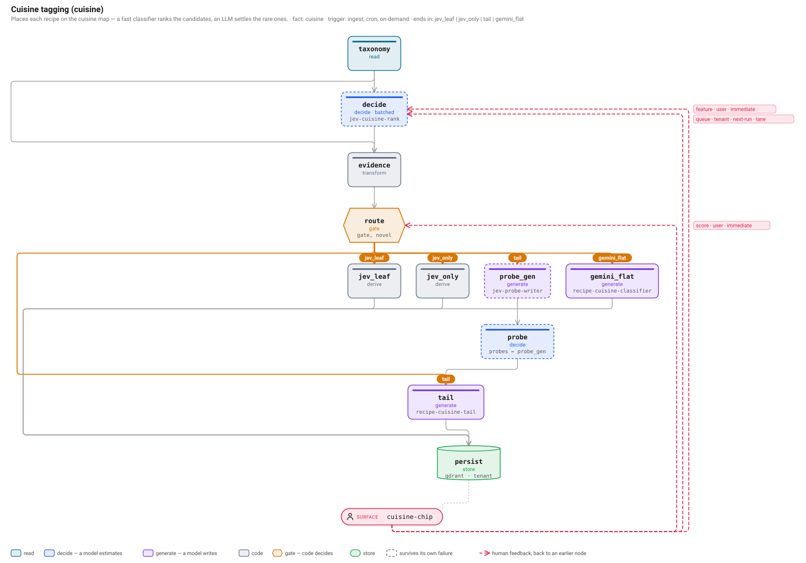

<h1 align="center">decision-pipeline</h1>

<p align="center">
  <b>Let models estimate. Let code decide. Let people correct it later.</b><br>
  The Python port of the decision-pipeline core: LLM features you can trace, tune and trust.
</p>

<p align="center">
  <a href="https://github.com/dipseth/decision-pipeline-python/actions/workflows/ci.yml"></a>
  <a href="LICENSE"></a>
  
  
</p>

<p align="center">
  
  &nbsp;
  
</p>

---

The Python port of the [decision-pipeline](https://github.com/dipseth/decision-pipeline) core (that repo's README explains the ideas; this one documents the Python package). It is the same core as the TypeScript package: the same manifest contract (`define_pipeline` checks the same rules and lists every violation at once), the same run record, and the same hashes, versions and fingerprints, so a run's composite version, cache keys and experiment arms come out identical in both languages. The only runtime dependency is [`pydantic`](https://docs.pydantic.dev) (v2). Your models, database and tracer plug in as ports, so the tests need no network.

## Install

Not on PyPI yet. Install it from GitHub:

```bash
pip install "decision-pipeline[jsonata] @ git+https://github.com/dipseth/decision-pipeline-python"
# or
uv add "decision-pipeline[jsonata] @ git+https://github.com/dipseth/decision-pipeline-python"
```

Python 3.10+. The `jsonata` extra (`jsonata-python`) is only needed for JSON specs and discovery; drop it if you write manifests in Python.

## Quick start

The triage pipeline from the [root README](https://github.com/dipseth/decision-pipeline#quick-start): a model estimates whether a ticket is a refund request, code gates on it, and a writer model runs only when the gate isn't sure.

```python
import asyncio

from pydantic import BaseModel

from decision_pipeline import (
    CodeNode, DecideNode, Edge, EdgeGuard, EvalSpec, FeedbackEdge, GateNode,
    GenerateNode, ScoreConfigSpec, StoreNode, define_pipeline, run_pipeline,
)
from decision_pipeline.testing import test_ports


class Ticket(BaseModel):
    id: str
    text: str


class Reply(BaseModel):
    text: str


def gate(args):
    p = (args.primary.get("refund") or [0])[0]
    if p >= args.thresholds["sure"]:
        return {"branch": "canned", "confidence": p}
    return {"branch": "writer", "reason": "not sure it's a refund", "confidence": p}


triage = define_pipeline(
    id="triage",
    fact="reply",                          # the one thing this pipeline produces
    input=Ticket,
    output=Reply,
    trigger=["on-demand"],
    group=lambda t: f"ticket-{t.id}",      # groups related runs in your tracer
    result=["canned", "check"],            # whichever of these ran is the answer
    nodes={
        # A model gives probabilities, never the answer.
        "classify": DecideNode(questions="is-refund-request", version="1"),
        # Code makes the call. Thresholds are data, so they can be tuned and recorded.
        "gate": GateNode(run=gate, branches=["canned", "writer"], thresholds={"sure": 0.8}, version="1"),
        # The cheap path: no generative model at all.
        "canned": CodeNode(role="derive", run=lambda a: {"text": "Your refund is on its way."}, version="1"),
        # The expensive path, only when the gate isn't sure.
        "writer": GenerateNode(prompt="support-reply", route="support-writer", version="1"),
        "check": CodeNode(role="validate", run=lambda a: a.primary, on_failure="revert", version="1"),
        "save": StoreNode(target="tickets-db", scope="user", version="1"),
    },
    edges=[
        Edge(from_="classify", to="gate"),
        Edge(from_="gate", to="canned", when=EdgeGuard(gate="gate", branch="canned")),
        Edge(from_="gate", to="writer", when=EdgeGuard(gate="gate", branch="writer")),
        Edge(from_="writer", to="check"),
        Edge(from_="canned", to="save"),
        Edge(from_="check", to="save"),
    ],
    # Where a human's thumbs up/down lands: on the gate, so its threshold can be re-tuned.
    feedback=[FeedbackEdge(
        id="thumbs", from_="surface:reply", to="gate",
        source="explicit", scope="user", form="score", latency="deferred",
        score=ScoreConfigSpec(name="reply_helpful", data_type="BOOLEAN"),
    )],
    eval=EvalSpec(dataset="triage-eval", gate_metric="score_positive"),
)


async def main():
    # In-memory ports, where a scripted "model" says 93% refund.
    ports = test_ports(decide={"classify": {"distributions": {"refund": [0.93, 0.07]}}})
    result = await run_pipeline(triage, Ticket(id="t-42", text="I was charged twice, please refund"), ports)

    print(result.route)          # canned: no generative model was called
    print(result.output.text)    # Your refund is on its way.
    for n in result.record.nodes:  # classify (with its distributions), gate (branch + thresholds),
        print(n.id, n.kind, n.branch or n.skipped or "")  # canned, save, writer and check skipped, with the reason


asyncio.run(main())
```

This prints:

```
canned
Your refund is on its way.
classify decide 
gate code canned
canned code 
writer generate gate took "canned", needed "writer"
check code writer skipped
save store
```

Script the model to say `[0.41, 0.59]` and the same pipeline takes the `writer` branch; the gate's node in the record then says `branch_reason == "not sure it's a refund"`.

Nodes and edges are plain `@dataclass(kw_only=True)` classes (`ReadNode`, `DecideNode`, `GenerateNode`, `CodeNode`, `GateNode`, `StoreNode`), but dict literals in the TS shape are accepted too, e.g. `{"kind": "decide", "questions": "is-refund-request", "version": "1"}` (with `"from"`/`"in"` spelled as in TS). In production you pass real ports instead of `test_ports()`.

## A decide port backed by Jev

The same short port as the [root README](https://github.com/dipseth/decision-pipeline#jev-llms-and-code-who-does-what), async, on `httpx`. It is illustrative and not run here; `load_questions` and `build_state` are yours. The wire helpers (`jev_answers_to_decide_result`, `jev_headers`, `check_jev_request`) ship with the package.

```python
import os

import httpx

from decision_pipeline import (
    JEV_ENDPOINT, JEV_MODEL, DecideRequest, DecideResult,
    check_jev_request, jev_answers_to_decide_result, jev_headers,
)


async def jev_decide(req: DecideRequest) -> DecideResult:
    probes = {slot: {k: v for k, v in q.items() if k != "why"} for slot, q in req.probes.items()}  # `why` is for humans only
    body = {
        "model": JEV_MODEL,  # "jev-1.14.0"
        "state": build_state(req.input),
        "questions": {**load_questions(req.questions), **probes},  # your fixed set + this run's probes
    }
    if problems := check_jev_request(body):  # e.g. a Box sent to jev-1.13.0
        raise ValueError("; ".join(problems))
    async with httpx.AsyncClient() as client:
        res = await client.post(JEV_ENDPOINT, headers=jev_headers(os.environ["TYPESAFE_API_KEY"], body), json=body)
    data = res.json()
    # noul -> [p], choice/score -> one probability per option, box -> `boxes` (see below)
    return jev_answers_to_decide_result(data["answers"], usage=data["usage"], cost_usd=lambda u: u.get("input_tokens", 0) * 0.042e-6)
```

With the official [`typesafe-sdk`](https://docs.typesafe.ai/sdk/python) (`pip install "decision-pipeline[typesafe]"`) the port is shorter: the client handles auth, retries, images as multipart and compression. Two things it does not do: send the danger-zone headers (`jev_extra_headers` does), and pin a model (its default is `jev-latest`; pass `JEV_MODEL`). The helpers read SDK objects (`Noul`, `Box`, `Image`, `SystemOneResponse`) as well as plain dicts.

```python
from typesafe_sdk import AsyncTypeSafeClient

from decision_pipeline import (
    JEV_MODEL, DecideRequest, DecideResult,
    check_jev_request, jev_extra_headers, jev_response_to_decide_result,
)

client = AsyncTypeSafeClient()  # reads TYPESAFE_API_KEY; reuse one client across requests


async def jev_decide(req: DecideRequest) -> DecideResult:
    state = build_state(req.input)  # may hold typesafe_sdk.Image objects anywhere
    questions = {**load_questions(req.questions), **{s: {k: v for k, v in q.items() if k != "why"} for s, q in req.probes.items()}}
    if problems := check_jev_request({"model": JEV_MODEL, "questions": questions}):
        raise ValueError("; ".join(problems))
    res = await client.system_one(
        state=state, questions=questions, model=JEV_MODEL,
        extra_headers=jev_extra_headers(questions, state),  # images header for a Box or an Image; long_context=True to opt in
    )
    return jev_response_to_decide_result(res, cost_usd=lambda u: u.get("input_tokens", 0) * 0.042e-6)
```

## Box: find where something is in an image

TypeSafe's October 2026 release puts three "danger zone" features behind per-request headers: **images** on every Jev, `jev-1.13.0` included (`TypeSafe-Danger-Zone-Images: true`), **longer context** (`TypeSafe-Danger-Zone-Long-Context: true`), and the **Box** question type on `jev-1.14.0` only: `` {"type": "box", "instructions": "the coffee mug in `photo`"} `` is answered with four edges as fractions of the image plus a `confidence`. They are dreamer-ready, not production-ready. `jev_headers` adds the images header when a request carries an image or a Box, and the long-context one only with `long_context=True`. The full write-up is in the [root README](https://github.com/dipseth/decision-pipeline#box-find-where-something-is-in-an-image); in short:

- The decide port returns boxes under `DecideResult.boxes`. The runtime checks each one (a bad box fails the node), records it on the node as `boxes`, and mirrors its confidence into `distributions` as `[confidence]` (option `"confidence"`), so a gate thresholds a Box exactly like a Noul.
- The edges reach code as `args.boxes["<decide node>"]["<question>"]` (`$boxes` in a JSON spec) and as an optional third argument to `interpret(distributions, args, boxes)`. The decide node's value keeps its shape.
- There is no "not found": ask a Noul ("Is there a coffee mug in `photo`?") beside the Box and gate on both.
- Geometry stays in code: `box_to_pixels` (PIL crop order), `pad_box`, `box_iou`, `tile_boxes` + `box_from_tile`, `edge_check_questions` + `expand_box_edges`. The record gains `<node>.<question>.box_area`, `.box_cx`, `.box_cy`.

```python
from PIL import Image
from decision_pipeline import CodeNode, box_to_pixels, pad_box

pad_crop = CodeNode(
    role="derive", version="1", thresholds={"pad": 0.05},
    run=lambda a: Image.open(a.input.path).crop(tuple(box_to_pixels(
        pad_box(a.boxes["locate"]["mug"]["box"], a.thresholds["pad"]), a.input.width, a.input.height,
    ).values())),
)
```

## What maps to what

| TypeScript | Python |
|---|---|
| `definePipeline(...)` | `define_pipeline(...)` (keyword arguments, a `PipelineSpec`, or a dict) |
| `from`, `in`, `args.in` | `from_`, `in_`, `args.in_` (also `DecideRequest.from_` / `.in_`) |
| `onFailure`, `costUsd`, `acceptsFeatures` | `on_failure`, `cost_usd`, `accepts_features` (every function, field and parameter is `snake_case`) |
| `testPorts(...)` | `decision_pipeline.testing.test_ports(...)` |
| `@rivers/decision-pipeline/jsonata` | `decision_pipeline.jsonata` (needs the `jsonata` extra) |
| `@rivers/decision-pipeline/testing` | `decision_pipeline.testing` |
| `pipeline.toJSON()` | `pipeline.to_json()` |
| zod schema | pydantic `BaseModel` subclass, `TypeAdapter`, or any object with `.parse()` |
| `Promise` / `async` host code | sync **or** async callables, accepted everywhere a host supplies code (node bodies, ports, observers, `interpret`) |
| `console.warn` | `logging.getLogger("decision_pipeline").warning` |

`run_pipeline`, `run_shadow`, `submit_feedback`, `propose_pipeline_spec`, `evaluate_hypothesis`, `collect_trial`, `judge_trial`, `discover_features` and `discover_for_spec` are `async def`. Classes and constants keep their TS names (`DecisionPipeline`, `RunRecord`, `PipelineContractError`, `MAX_PROBES`).

**The JSON wire formats are byte-identical to TypeScript.** Pipeline specs, hypotheses, manifest patches, `to_json()` output and run records use the same keys, so a spec written for one language runs on the other, and a run record from one can be joined with the other's. The JSON spec and hypothesis formats keep their camelCase keys (`onFailure`, `gateMetric`, `minEffect`); the run record is snake_case in both. See [`PORTING.md`](PORTING.md) for the full conventions.

## Ports

The core imports no model SDK, database or tracing vendor. Every side effect goes through a port you supply:

| Port | You provide | In-memory version in `decision_pipeline.testing` |
|---|---|---|
| `decide` | A model that returns probabilities per question | `scripted_decide` |
| `generate` | A model that writes, with tools | `scripted_generate` |
| `store` | Where the fact is saved | `collecting_store` |
| `tracer` | Spans. Its root trace id becomes the run id | `recording_tracer` |
| `prompts` | Prompt versions and configs | `static_prompts` |
| `thresholds` | Runtime overrides for thresholds (env, remote config) | via `test_ports(env=...)` |
| `scope` | Who is asking (user, tenant…) and what they may do | `static_scope` |
| `tool_registry` | Which tools exist, and the permission each needs | `static_registry` |
| `cache` | Skip a node whose input was already seen | `memory_cache` |
| `scores` · `queue` · `dataset` | Where feedback, review items and eval runs go | `collecting_scores` · `collecting_queue` · `collecting_dataset` |
| `observers` | Anything that only *watches*: a record sink, a cost meter | `collecting_observer` |

A port returns something the run uses; an observer only watches, and one that raises is logged and skipped. See [Ports](https://github.com/dipseth/decision-pipeline#ports-bring-your-own-everything).

## Specs, propose, shadow, trial, discover

The ideas are explained in the root README; this is where the Python names are.

- **Specs.** `compile_pipeline_spec(json, registry, engine)` returns a result with `pipeline` and `problems` and never raises; `pipeline_from_spec` raises a `PipelineContractError` instead. Build the registry with `define_registry(primitives=, functions=, schemas=, features=)` (schemas are pydantic models) and the engine with `decision_pipeline.jsonata.jsonata_engine()`. `describe_registry` and `pipeline_spec_json_schema` are what a model reads to write one. See [Pipelines as data](https://github.com/dipseth/decision-pipeline#reference).
- **Propose.** `await propose_pipeline_spec(...)` asks your model port for a changed pipeline as JSON and repairs it until it compiles. See [Improving a pipeline safely](https://github.com/dipseth/decision-pipeline#improving-a-pipeline-safely).
- **Shadow.** `await run_shadow(...)` runs a challenger beside the champion; the champion's output is unchanged, and the challenger's writes are captured, never stored.
- **Trial.** `compile_hypothesis` and `lock_hypothesis` fix the claim before data arrives, `await collect_trial(...)` gathers paired rows, and `await judge_trial(...)` returns *supported*, *refuted* or *inconclusive*. `plan_hypothesis` sizes a claim before any data exists, and `define_metric` adds your own metric.
- **Discover.** `await discover_features(rows=, base_names=, target=, ports=DiscoverPorts(author=, answer=))` runs the loop, and `await discover_for_spec(spec=, rows=, ..., attach=LearnedGateAttach(...), check={"registry": ..., "engine": ...})` returns a patched spec, the fitted `model` and the `question_set` to publish (`DiscoverResult.to_dict()` / `from_dict()` use the TS JSON shape). `attach_learned_gate` is the pure half. See [Discover](https://github.com/dipseth/decision-pipeline#discover-let-the-errors-write-the-next-questions) and the worked example in [`examples/wine/run.py`](examples/wine), which replays the same Jev cache as the TS version.

## Deadlines, skips and failed runs

A node may declare `timeout_ms=`. Past it the node fails with `NodeTimeoutError`, so its `on_failure` decides what the run does, and the `signal` handed to the body and its port (an `AbortSignal` with `.aborted`) is aborted; a late answer is never written into the run. A body or port that raises `NodeSkipped("reason")` is recorded as skipped, not failed, whatever its `on_failure`. An observer that implements `on_run_fail(event)` hears about a run that threw: the nodes it had considered and what they cost. A failed run never reaches the record sink.

## Draw it, explain it

Both work from `pipeline.to_json()` and match the TypeScript output byte for byte:

```python
from decision_pipeline import render_pipeline_svg, explain_pipeline, explain_cache_key

svg = render_pipeline_svg(pipeline.to_json(), title="Scale")          # one SVG string, no dependencies
key = explain_cache_key(pipeline.to_json(), level="eli10", language="es")
explanation = await explain_pipeline(pipeline.to_json(), level="eli10", title="Scale",
                                     language_name="Spanish", generate=my_model)   # generate(prompt) -> str
```

The two production pipelines from the TypeScript README, drawn by this package (the output is identical to the TypeScript renderer, byte for byte). Left, **Scale**; right, **Cuisine tagging**:

<p align="center">
  
  &nbsp;
  
</p>

See [Draw any pipeline](https://github.com/dipseth/decision-pipeline#draw-any-pipeline) and [Explain any pipeline](https://github.com/dipseth/decision-pipeline#explain-any-pipeline) for how to read them.

## Develop

```bash
uv sync --extra jsonata
uv run pytest
uv run mypy decision_pipeline
```

The tests need no network. `decision_pipeline.fixtures` holds a complete example manifest, and `decision_pipeline.testing` has the in-memory ports for your own app's tests.
